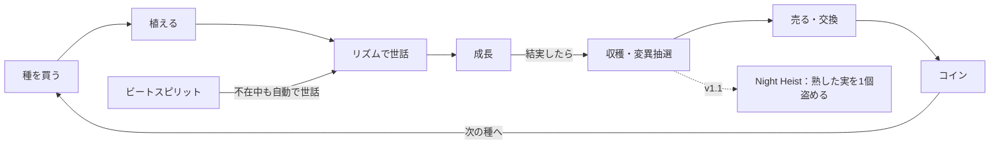

# Beat Garden 詳細仕様書（BEAT WORKS #1）

Nov 4, 2026 · @隊長

## 概要

Beat Gardenは「音で育てて、音で守る、音で奪う」育成×収集ゲーム。Grow a Garden型の実績あるループに、リズム入力を差別化の核として載せる。BEAT WORKSシリーズ第1作で、シリーズの収益の柱を担う。

| 項目 | 決定内容 |
| --- | --- |
| ジャンル | 育成×収集×交換（Grow a Garden型）＋リズム入力 |
| 奪い合い | ちょい盗み「Night Heist」。v1.1で導入、MVPには入れない |
| アート | 昼夜切替。昼＝パステルで育成、夜＝ネオンで泥棒タイム |
| 変異の表現 | カラーグレードのルック名（Neon / Aurora / Golden Hour / Vapor / Film） |
| 言語・市場 | 英語ベース×Japanese Kawaii。英語・日本語は手動、他言語は自動翻訳 |
| ターゲット | Robloxの主要層（10代以下中心）。モバイル優先 |
| 開発体制 | 原則として全編AI開発（Claude Code＋Studio MCP＋Open Cloud） |

### シリーズ内の位置づけ

- \#1 Beat Garden：収益の柱、長期運営
- \#2 Beat Party：交流・見せびらかし。シリーズのハブ
- \#3 Beat Run：パルクール×リズム。低コストで新規の入口
- 共通資産：リズムエンジン、楽曲ライブラリ（グループ所有）、譜面生成パイプライン、作品間の報酬連携

## コアループとゲームシステム

プレイヤーは種を植え、リズムで世話をして育て、変異したレアな実を集めて売るか交換する。放置でも育つが、リズムで世話した方が圧倒的に速く、レアも出やすい。



※リズムで世話するとき、Perfectの連続で変異率が上がる。

ループの中心は「リズムで世話」。ここでの精度が成長速度と変異の出やすさの両方を決める。

### 1. 種（Beat Seeds）

- 種1種＝楽曲1曲。曲のBPMとジャンルで、世話の譜面と植物の見た目が決まる
- レア度：Common / Uncommon / Rare / Epic / Legendary
- ショップの在庫は5分ごとに入れ替え（数値は調整対象）。レア種は低確率で入荷

### 2. 世話＝リズムミニゲーム（差別化の核）

- 植物に近づいて「Tend」を押すと、その種の曲で10〜15秒の4レーン譜面が始まる
- 判定はPerfect / Great / Good / Miss。精度に応じて成長ポイントを加算
- 同じ植物は一定時間（例：60秒）再世話不可。複数の植物を順に回る動線を作る
- モバイルは移動画面とリズム画面を分け、リズム中はオーバーレイ表示

### 3. 成長

- 段階：種 → 芽 → 若木 → 開花 → 結実（収穫可）
- 成長＝時間経過（オフライン中も進む）＋世話ポイント
- 結実した実は放置すると一定時間で「熟しすぎ」になり価値が下がる（再訪の動機）

### 4. 変異（Mutation）

- Perfectの連続数に応じて、結実時に変異の抽選
- 変異＝実のルック（カラーグレード）が変わり、売値に倍率がかかる
- サーバーイベント「BPM Rush」中は特定の変異が出やすい

### 5. 収穫・売却

- 収穫した実は所持品へ。マーケットのNPCに売却してコインを得る
- 売値＝基本価格 × 変異倍率 × 重さ（ランダム幅）

### 6. ビートスピリット（ペット）

- 卵から孵化。装備すると不在中も自動で世話（精度は低め）
- スピリットごとにパッシブ効果（成長速度、特定変異の確率アップなど）

### 7. 交換

- プレイヤー間で実・種・スピリットを交換。双方確認の2段階承認
- 詐欺対策として、交換画面に相手の提示物の推定価値を表示

### 8. Night Heist（v1.1）

- 1時間ごとに5分間の「夜」。他人の庭に侵入できる
- 盗めるのは熟した実を1回1個まで。変異したレアは持ち主がオンライン中のみ対象
- 持ち主がいれば8秒のリズム決闘、不在ならNPCの番人と勝負
- 盗まれた側には仕返しチケット。防衛に成功すると次の収穫にボーナス
- 防衛強化は課金可能だが、買えば絶対に守れる仕様にはしない

### 9. サーバーイベント

- BPM Rush：音楽ジャンルが切り替わり、対応する変異の確率アップ
- 新曲追加＝新しい種の追加。毎週1〜2曲のペースで追加し、楽曲制作がそのまま運営コンテンツになる

## アート・演出仕様

同じ庭がルックだけで昼と夜に一変することを最大の見せ場にする。世界観は盆栽・提灯・神社の庭などの和モチーフを、パステルとネオンで現代的に仕上げた「Japanese Kawaii」。

### 昼夜の切替

| 時間帯 | トーン | 役割 | 演出 |
| --- | --- | --- | --- |
| 昼 | パステル、柔らかい光 | 育成・世話・収穫 | 植物がビートに合わせて揺れる |
| 夜 | ネオン、暗い背景に発光 | Night Heist、イベント | 植物と実がビートで発光、提灯が明滅 |
| 遷移 | 約5秒のグレーディング遷移 | 夜の到来を告知 | 色温度とコントラストが段階的に変化 |

### 変異ルック定義

| 変異名 | ルックの方向性 | 売値倍率（初期値） | レア度 |
| --- | --- | --- | --- |
| Film | 低彩度、粒子感、暖色寄り | ×1.5 | 出やすい |
| Vapor | ピンク×シアンのベイパーウェイブ | ×2 | やや出やすい |
| Golden Hour | 金色の逆光、高い色温度 | ×3 | 中 |
| Neon | 高彩度の発光、黒背景で映える | ×5 | 低 |
| Aurora | 色相が時間で巡る | ×10 | 最低 |

倍率と出現率はMVPのプレイデータを見て調整する。

### パレットとトーン統一

- シリーズ共通のマスターパレットを定義し、AI生成素材はすべてこのパレットに寄せる
- 素材は生成後にルック調整してから取り込む（ばらつき対策）
- サムネイルとアイコンもマスターパレットから作る

#### マスターパレット v1

昼と夜で同じ5つの色相を共有し、明度と彩度だけを変える。昼夜の切替が「グレーディングの違い」として見えるようにするため。

| 色相 | 昼（パステル） | 夜（ネオン） | 固定の役割 |
| --- | --- | --- | --- |
| Sakura | #F7C6D9 | #FF4FA3 | レーン1 |
| Sora | #BFDDF5 | #3FC8FF | レーン2、Rare |
| Matcha | #BFE3C0 | #3DFFB0 | レーン3、Uncommon |
| Yuzu | #FBE7A1 | #FFE14D | レーン4、Legendary |
| Fuji | #D8C8F0 | #A86BFF | Epic（夜版を使う） |

| ベース・アクセント | 色 | 用途 |
| --- | --- | --- |
| Washi | #FFF8F0 | 昼の地、夜の文字 |
| Sumi | #3B3346 | 昼の文字、植物の輪郭線 |
| Yoru 夜空 | #14112B | 夜の空 |
| Yoru 地面 | #231E45 | 夜の地面 |
| Torii | #FF5A3C | 購入・決定ボタン（1画面に1つまで） |

| 変異ルック | 基準色 |
| --- | --- |
| Film | #D9C7A7 |
| Vapor | #FF71CE / #01CDFE |
| Golden Hour | #FFB347 |
| Neon | 夜パレットを流用 |
| Aurora | Matcha → Sora → Fuji（夜版）の循環 |

- 4レーンは色だけで区別しない。ノーツの形も変える（丸、三角、四角、ひし形）
- 昼のWashiの上でパステルが沈む場合は、植物の輪郭にSumiの細い線を入れる
- コード上の定義は [Palette.luau](../src/shared/Palette.luau)（ReplicatedStorage の ModuleScript）に一元化する

### Robloxでのルック再現

- Robloxは任意のLUTを直接読み込めない前提で設計する（着手時に要確認）
- ルックはColorCorrectionEffect（明るさ・コントラスト・彩度・色味）、BloomEffect、Atmosphere、Lightingの組み合わせでプリセット化する
- 変異した実個別のルックは、マテリアル色＋発光（PointLight / Highlight）＋パーティクルで表現する
- 低スペック端末ではBloomとパーティクルを自動で軽量化する

## 画面遷移・UI

メインは3Dの庭で、UIはオーバーレイとモーダルで重ねる。子ども向けなのでアイコン主体、文字は最小限にする。

| 画面 | 種類 | 主な要素 | 開き方 |
| --- | --- | --- | --- |
| 庭（メイン） | 3Dワールド | 自分の区画、植物、HUD | 入室時 |
| HUD | 常時表示 | コイン、昼夜タイマー、所持品ボタン、ショップボタン | 常時 |
| リズムオーバーレイ | 全画面オーバーレイ | 4レーン、判定表示、コンボ、成長ゲージ | 植物でTend |
| 種ショップ | モーダル | 在庫一覧、入れ替えまでの残り時間、購入 | ショップNPCまたはボタン |
| マーケット（売却） | モーダル | 所持品から選択、売値プレビュー | 売却NPC |
| 所持品 | モーダル | 実・種・スピリット・卵のタブ | HUDボタン |
| スピリット | モーダル | 孵化、装備、効果表示 | 所持品から |
| 交換 | モーダル | 双方の提示物、推定価値、2段階承認 | 他プレイヤーをタップ |
| 設定 | モーダル | 遅延キャリブレーション、音量、言語、軽量モード | HUDの歯車 |
| 初回チュートリアル | ガイド | 植える→世話→収穫→売却を1周 | 初回入室時 |

### リズムオーバーレイ

- 4レーン、ノーツは上から下へ。下部のタップ領域はモバイルの親指位置に合わせる
- PC：D / F / J / K、モバイル：画面下部の4ボタン、ゲームパッド：対応ボタン
- 精度に応じて背景の植物が光る（世話の結果が目に見える）
- 終了時に「成長+X」と変異抽選の演出

### 初回体験（最初の3分）

1. 無料の種を1つ受け取り、植える
2. その場でTendして初めてのリズム体験（易しい譜面）
3. チュートリアル用の種は即結実。収穫して売り、コインで次の種を買う

### 多言語

- 英語と日本語は手動で翻訳データを用意
- それ以外はRobloxの自動翻訳に任せる
- UI文字列はすべて翻訳テーブル経由。ハードコード禁止

## データ設計

マスターデータ（種・譜面・変異）と、プレイヤーデータを分ける。マスターデータはOpen Cloud経由で更新し、ゲームの再公開なしで新曲・新種を追加できる構成にする。

### 種マスター（seed）

```json
{
  "seedId": "seed_sakura_pop",
  "name": {"en": "Sakura Pop", "ja": "さくらポップ"},
  "rarity": "Rare",
  "songId": "song_012",
  "price": 250,
  "growSeconds": 600,
  "baseSellPrice": 80,
  "stockWeight": 0.08,
  "model": "rbxassetid://...",
  "mutationBias": {"Vapor": 1.5},
  "active": true
}
```

### 楽曲・譜面マスター（song / chart）

```json
{
  "songId": "song_012",
  "audioAssetId": "rbxassetid://...",
  "regionStartMs": 90000,
  "regionEndMs": 180000,
  "bpm": 128,
  "offsetMs": 42,
  "genre": "future_bass",
  "charts": {
    "tend": [
      {"segment": 0, "startMs": 15000, "notes": [[0, 15000], [2, 15234], [1, 15469]]},
      {"segment": 1, "startMs": 45000, "notes": []}
    ],
    "duel": []
  }
}
```

- notesは \[レーン(0-3), 時刻ms\] の配列。容量を抑えるため短い形式にする
- 世話用の10〜15秒区間（segment）を1曲から複数切り出し、毎回ランダムに選ぶ

音源は**メドレー方式**で管理する。1ファイルに約4曲（各90秒前後）をつなげてアップロードし、regionStartMs / regionEndMs で曲ごとの再生範囲を指定する（SoundのPlaybackRegionを使用）。1アップロードで約4曲分になり、月ごとのアップロード上限内で曲数を増やせる。

#### 曲の長さ（レア度別）

| レア度 | 曲の長さ | 1ファイルの曲数 | 世話区間（15秒）の数 |
| --- | --- | --- | --- |
| Common / Uncommon | 60秒 | 約5〜6曲 | 3〜4区間 |
| Rare / Epic / Legendary・イベント曲 | 90秒 | 約4曲 | 5〜6区間 |

#### 楽曲の制作ルール

- 頭の15秒以内にフック（サビの要素）を入れる。どの区間を切り出してもその種の曲だと分かるようにする
- 1曲の中でBPMを変えない（譜面の自動生成を安定させるため）
- メドレーの曲間に1秒の無音を入れる（切り出し時のノイズ対策）

### 変異マスター（mutation）

```json
{"mutationId": "Neon", "multiplier": 5, "baseChance": 0.01, "lookPreset": "look_neon", "perfectStreakBonus": 0.002}
```

### プレイヤーデータ（1プレイヤー1キー）

```json
{
  "v": 1,
  "coins": 1200,
  "plots": [
    {"slot": 1, "seedId": "seed_sakura_pop", "plantedAt": 1762240000, "careGauge": 340, "lastTendAt": 1762240300}
  ],
  "inventory": {"fruits": [{"seedId": "...", "mutation": "Neon", "weight": 1.2}], "seeds": {}, "eggs": {}},
  "spirits": [{"id": "sp_01", "equipped": true}],
  "settings": {"latencyMs": 60, "lang": "ja", "lite": false},
  "stats": {"tends": 120, "perfects": 860}
}
```

### DataStore構成

| DataStore | キー | 内容 | 更新元 |
| --- | --- | --- | --- |
| Master\_Seeds | seedId | 種マスター | Open Cloud |
| Master\_Songs | songId | 楽曲・譜面 | Open Cloud |
| Master\_Mutations | mutationId | 変異マスター | Open Cloud |
| Players | userId | プレイヤーデータ | ゲームサーバー |
| Trades\_Log | tradeId | 交換履歴（不正調査用） | ゲームサーバー |

- プレイヤーデータはセッションロック付きで保存（ProfileStore系の実装パターン）
- マスターデータはサーバー起動時に読み込み、MemoryStoreでキャッシュ
- ショップの在庫入れ替えはMemoryStoreで全サーバー共通の時刻に同期

### 共通リズムエンジン（シリーズ共有）

- `RhythmEngine`（ModuleScript、パッケージ化して3作で共有）
  - 譜面の再生、判定窓（Perfect ±45ms / Great ±90ms / Good ±135ms を初期値）
  - 遅延キャリブレーションの適用
  - 結果のサマリ（判定数、最大コンボ、タイムスタンプ列）を返す
- 判定はクライアントで行い、サーバーは結果を検証する
  - ノーツ数・曲長・タイムスタンプの整合性、人間離れした精度の連続を弾く
  - Night Heistの決闘はサーバー側の検証を厳しめにする

## 収益化

「時間を買う」「見た目を買う」を中心にし、勝敗を直接買える要素は作らない。価格は仮置きで、MVPのデータを見て調整する。

| 種類 | 商品 | 内容 | 仮価格 | 導入 |
| --- | --- | --- | --- | --- |
| ゲームパス | Double Growth | 成長速度2倍（永続） | 199 R$ | MVP |
| ゲームパス | Extra Plot | 区画を+4 | 149 R$ | MVP |
| ゲームパス | VIP | 新曲の種を先行入手、限定スピリット、VIPエリア | 399 R$ | v1.1 |
| ゲームパス | Night Guard+ | 番人スピリットの強化（完全防御ではない） | 149 R$ | v1.1 |
| デベロッパープロダクト | Instant Grow | 1区画を即結実 | 25 R$ | MVP |
| デベロッパープロダクト | Restock | ショップ在庫を即入れ替え（自分だけ） | 39 R$ | MVP |
| デベロッパープロダクト | Look Sprinkler | 一定時間、変異確率アップ | 49 R$ | MVP |
| デベロッパープロダクト | 限定イベント種 | 期間限定曲の種 | 99 R$〜 | v1.1 |

### 収益の柱以外

- Creator Rewards：滞在時間と再訪が評価に効く。世話の回遊動線と熟しすぎの仕組みで滞在を伸ばす
- リワード広告：使える条件を満たしたら、Instant Growの無料版として導入を検討

### 守るべきルール

- 有料のランダム要素（卵など）は確率を表示する
- 日本向けにはコンプガチャ規制に抵触しない設計にする（特定の組み合わせを揃えると報酬、は作らない）
- 子ども層が主要なので、課金の導線は控えめに。課金しないと楽しめない設計にしない

## AI開発パイプライン

開発はClaude Code＋Studio MCP、運用（新曲・新種の追加）はスクリプト＋Open Cloudで回す。人が担うのは手触りの調整、アートの最終判断、テストプレイの3つ。

### 開発環境

- Claude Code ↔ Studio MCP：スクリプトの読み書き、Luau実行、プレイテスト、ビューポート確認
- Rojo＋Git：コードはローカルのファイルとしてGitで管理
- Robloxグループで楽曲と共通アセットを所有し、3作で共有

### 新しい種（曲）を追加する流れ

1. 楽曲を生成（AI音楽ツール、商用利用可プラン）。曲調は種のジャンル定義に合わせる
2. Python（librosa）でBPM・オンセットを検出し、譜面JSONを自動生成
3. Claudeで難易度調整と世話用の区間（segment）を選定
4. 約4曲をつなげたメドレーファイルにまとめ、Open Cloudでアップロード（1ファイル＝約4曲で月の上限対策）
5. Open CloudでMaster\_Songs / Master\_SeedsのDataStoreに投入
6. Luau Execution APIで、テスト用placeに対して譜面の整合性チェックを実行
7. 確認後、種をactive=trueにして公開（ゲームの再公開は不要）

### 公開の流れ

1. mainブランチへのマージで、Rojoビルド → Place Publishing APIでテスト用placeに保存
2. Studio MCPでプレイテスト（自動テスト＋目視）
3. 問題なければ本番placeに公開

### 必要なOpen Cloud APIキーのスコープ

- universe-places:write（placeの公開）
- universe.place.luau-execution-session:write / read（自動テスト）
- DataStoreの読み書き
- アセットのアップロード（音源・画像）

## MVPスコープとタスク分解

MVPは6週間で「植える→リズムで世話→変異→収穫→売る→次の種を買う」の1ループが楽しいかを検証する。Night Heist、VIP、イベントはv1.1に回す。

### MVPに含めるもの

- 種12種（12曲、メドレー3ファイル）、変異3種（Film / Vapor / Golden Hour）、スピリット2種
- 世話、収穫、売却、ショップ、所持品、交換
- 昼夜切替（演出のみ。夜のゲーム要素はv1.1）
- 課金：Double Growth、Extra Plot、Instant Grow、Restock、Look Sprinkler

### Week 1：基盤

- [ ] Robloxグループ作成、Rojo＋Git環境、Studio MCP接続
- [ ] RhythmEngine（譜面再生・判定・遅延補正）の試作
- [ ] 譜面自動生成スクリプト（librosa）の試作、テスト曲1曲で検証

### Week 2：コアループ

- [ ] 区画・植え付け・成長・収穫のサーバーロジック
- [ ] 世話オーバーレイとRhythmEngineの接続
- [ ] プレイヤーデータの保存（セッションロック付き）

### Week 3：経済と収集

- [ ] ショップ（在庫入れ替えの全サーバー同期）、売却、所持品
- [ ] 変異の抽選と倍率、スピリット2種
- [ ] 楽曲12曲の制作（メドレー3ファイル）と譜面生成、Open Cloudでの投入

### Week 4：アートと演出

- [ ] マスターパレット確定、庭・植物・実のモデル（AI生成→ルック調整）
- [ ] 昼夜切替のライティングプリセット、変異ルック3種
- [ ] モバイルUI、低スペック向け軽量モード

### Week 5：交換・課金・初回体験

- [ ] 交換（2段階承認、推定価値表示、ログ）
- [ ] ゲームパスとデベロッパープロダクトの実装
- [ ] チュートリアル、英語・日本語の翻訳データ

### Week 6：テストとローンチ

- [ ] Discordでテスター募集、クローズドテスト
- [ ] 判定の手触り・難易度・経済バランスの調整
- [ ] サムネイル・アイコン作成、公開、少額の広告テスト

### KPI

| 指標 | 見るポイント |
| --- | --- |
| D1継続率 | 広告に予算を寄せるかの判断基準。低いうちは出稿しない |
| 平均セッション時間 | 世話の回遊が機能しているか |
| 世話の実行回数／セッション | リズム入力が楽しいか、面倒になっていないか |
| 課金率 | 価格と商品の妥当性 |
| 交換の件数 | 収集欲が生まれているか |

### リスクと対策

- 世話が作業化する → 譜面の区間をランダム化、短く保つ、スピリットで代行可能にする
- モバイルの入力遅延 → 遅延キャリブレーションを初回に案内
- 経済のインフレ → 売値と成長時間をマスターデータで即調整できるようにしておく
- 音源アップロードの月上限 → メドレー方式で1ファイル約4曲。電話・ID認証で上限も上げる。脇役の曲はRoblox公式のライセンス楽曲で補い、看板曲は自作にする
- AI素材のトーンのばらつき → マスターパレットとルック調整を必須工程にする

## 進行表

ローンチは冬休みの入り口となる2026年12月24日。年末年始の高トラフィック期に乗せ、数値を見てv1.1（3月）、シリーズ2作目（3月着手）へ進む。

| 工程 | 期間 |
| --- | --- |
| 準備 | 2026/11/5〜11/11 |
| MVP開発 | 11/12〜12/16 |
| クローズドテスト | 12/17〜12/23 |
| **ローンチ** | **12/24** |
| 広告テスト | 12/24〜2027/1/6 |
| 数値改善 | 1/7〜1/31 |
| 週次の新曲追加 | 1/7〜（継続） |
| v1.1開発 | 2/1〜2/28 |
| v1.1リリース | 3/1 |
| #2 Beat Party | 3/1〜4/15 |
| #3 Beat Run | 4/16〜5/31 |

週次の新曲追加は数値改善期から始め、以降ずっと続ける運営の柱。

### 判定ポイント

| 判定 | 時期 | 進める条件 | 満たさないとき |
| --- | --- | --- | --- |
| ローンチ判定 | 12/23 | 致命的なバグがない、世話の手触りにテスターの不満が少ない | ローンチを1週間延期 |
| 広告継続判定 | 1/6 | D1継続率が目標値以上（目標値はクローズドテストの結果から設定） | 広告を止めて数値改善に集中 |
| v1.1着手判定 | 1/31 | 平均セッション時間と課金率が改善傾向 | 数値改善を2月まで延長し、v1.1は後ろ倒し |
| #2着手判定 | 2/28 | 新曲追加がパイプラインで自動化され、週次運営が回っている | #2の着手を延期し、Beat Gardenの運営を優先 |

### 今週やること（11/5〜11/11）

- [x] Robloxアカウントの電話・ID認証（音源アップロード上限の引き上げ）
- [x] Robloxグループ（コミュニティ「BEAT WORKS」）の作成（11/7）
- [ ] Claude CodeとStudio MCPの接続、Rojo＋Gitの環境構築
- [ ] Open Cloud APIキーの発行（必要なスコープはAI開発パイプラインの節を参照）
- [ ] 音楽生成ツールの商用利用規約の確認
- [ ] 最初のメドレー1ファイル（60秒×5〜6曲）の制作
- [x] マスターパレットの初案（v1、Palette.luau）
